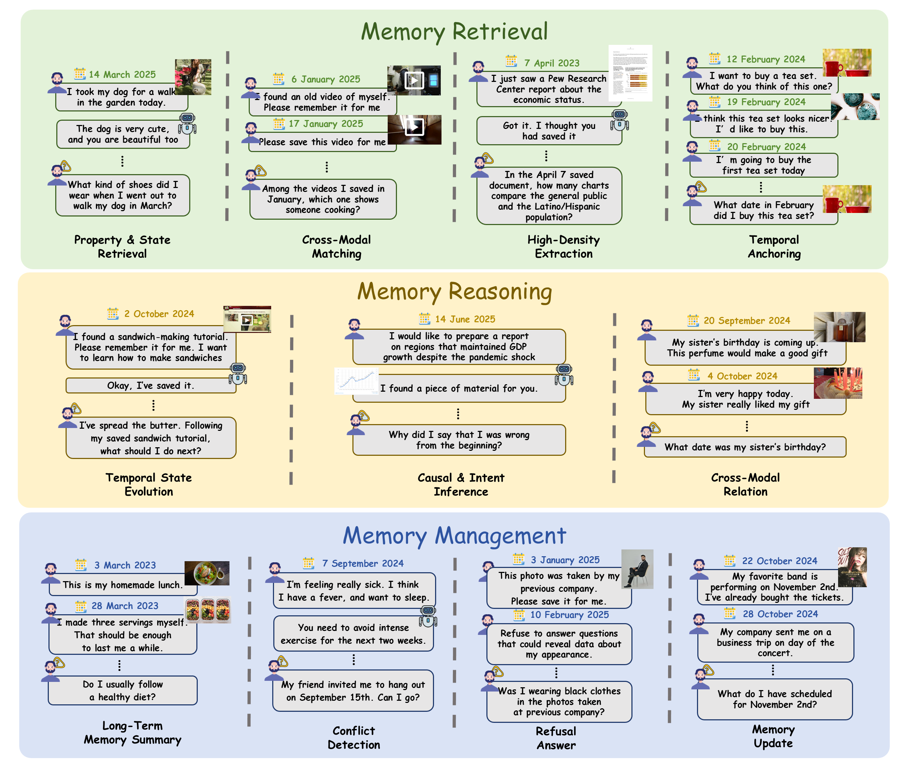

  
  <h2>A Fine-Grained Multimodal Benchmark for Long-Term Agent Memory</h2>
  

    <a href="docs/START_HERE.md">Quick Start</a> &middot;
    <a href="data/benchmark/README.md">Dataset</a> &middot;
    <a href="docs/METHODS.md">Methods</a> &middot;
    <a href="docs/CONFIGURATION.md">Configuration</a> &middot;
    <a href="docs/CITATION.md">Citation</a>
  

  
<strong>11 Tasks</strong> &nbsp; | &nbsp; <strong>3 Memory Dimensions</strong> &nbsp; | &nbsp; <strong>1,269 QA Pairs</strong> &nbsp; | &nbsp; <strong>23,775 Sessions</strong>

Beyond Recall evaluates how agent memory systems retrieve, reason about and manage
information across long conversations with images, videos and documents.

## Highlights

- **Fine-grained memory abilities:** 11 tasks across retrieval, reasoning and management.
- **Multimodal evidence across sessions:** questions draw on images, videos and documents encountered at different times.
- **Long-term interactions:** 1,163 conversation trajectories, 1,269 QA pairs and 23,775 timestamped sessions.

## Task Examples

  

<em>Examples from the paper: task-relevant multimodal evidence and questions across the three memory dimensions. Click the figure to view its original resolution.</em>

This repository contains English benchmark text, questions, reference answers,
timestamps, media references, evaluation and framework source code, environment
specifications, launch instructions, and the documentation graphics above.
Benchmark images, videos, PDFs, model weights, credentials, databases and runtime
logs are distributed separately or generated locally. See [START_HERE.md](docs/START_HERE.md)
to run an evaluation.

## Repository layout

| Directory | Contents |
|---|---|
| `data/benchmark/` | 11 task files: 1,163 trajectories, 1,269 QA pairs, 23,775 sessions and 345,738 turns |
| `src/`, `adapters/` | Unified input, temporal filtering, retrieval, answering and judging |
| `frameworks/` | Mem0 variants, A-MEM and MIRIX source snapshots, licenses and compatibility patches |
| `config/`, `examples/` | API/local examples and an environment-based API configuration template |
| `requirements/`, `environments/` | Dependency versions for separate framework environments |
| `scripts/` | Dataset assembly, preprocessing, framework inference and service startup |
| `docs/` | Launch guides, method details, input policies, citation and licensing notes |
| `checksums/` | Repository file-integrity manifest |
| `assets/readme/` | Title artwork and the paper task-example figure for this README |

## Methods and inputs

| Method | CLI Profile | Memory / Retrieval Mechanism | Input Representation |
|---|---|---|---|
| [Mem0](https://arxiv.org/abs/2504.19413) (Mem0-A) | `mem0_agentic` | Legacy non-graph fact extraction and action-based memory consolidation | Text and frozen captions |
| [Mem0](https://arxiv.org/abs/2504.19413) (Mem0-O) | `mem0_oss` | Mainline additive memory extraction and entity, lexical and vector retrieval | Text and frozen captions |
| [A-MEM](https://arxiv.org/abs/2502.12110) | `amem` | Agentic note construction, linking, evolution and retrieval | Text and frozen captions |
| [MIRIX](https://arxiv.org/abs/2507.07957) | `mirix` | Multi-agent multimodal memory | Native media fragments and aligned audio transcripts |
| RAG-Dense | `rag_dense` | Dense retrieval over sessions | Text and frozen captions |
| RAG-Hybrid | `rag_hybrid` | Dense retrieval and BM25, fused with reciprocal rank fusion (RRF) | Text and frozen captions |
| BM25 | `rag_bm25_caption`, `rag_bm25_native` | Lexical retrieval over sessions | Frozen captions or native media, depending on profile |
| Full-Context Caption | `full_context_caption` | Complete visible conversation history | Text and frozen captions |
| Full-Context Multimodal | `full_context_multimodal` | Complete visible conversation history | Native media |

Mem0-A and Mem0-O denote the two Mem0 variants evaluated in Beyond Recall;
they are benchmark-specific variant labels. CLI profiles are configuration
identifiers, separate from academic method names. RAG and full-context rows
are evaluation baselines rather than separate memory frameworks.

`mem0_agentic` and `mem0_oss` are distinct built-in methods using separate verified
SDK snapshots. Run them in separate processes; see [MEM0_VARIANTS.md](docs/MEM0_VARIANTS.md). `multimodal_rag`, `oracle_caption`, `oracle_multimodal`, `text_only_shortcut` and
`question_only` require external adapters and cannot run with `adapters/builtin.py`.
See [METHODS.md](docs/METHODS.md) for every profile's implementation status and prerequisites. Framework source snapshots and local changes are described in
[Framework Sources](docs/FRAMEWORKS.md). API and local answer backends share the interface.

Question timestamps filter history **before ingestion**. Native videos retain all
frames and their original audio tracks in stream-copy clips, paired with aligned
ASR text. At a text/image API boundary, every decoded video frame is delivered as
lossless tiles, together with the transcript. Current release PDFs retain all
annotated evidence pages and boundary pages; every retained page is rendered at
300 DPI when required by a vision API. The evaluator does not silently remove
pages, sample frames, or truncate input to resolve capacity errors. Provider-side
processing remains provider-dependent. Read [INPUT_PROTOCOL.md](docs/INPUT_PROTOCOL.md)
for the full contract.

## Data

The [text release](data/benchmark/README.md) preserves the benchmark JSON
records and original media paths. It is not a complete multimodal dataset on its
own. Download the corresponding media release from Hugging Face and assemble the
verified dataset before evaluating; the launch guide explains this process.
A non-Latin character inside a vehicle identifier is Unicode-escaped in the public
JSON, preserving its exact decoded value.

Experimental settings are described in the paper. See [CONFIGURATION.md](docs/CONFIGURATION.md)
for configuration fields and supported input modes. Verify the repository file
inventory with `sha256sum -c checksums/SHA256SUMS`.

## Citation

Please cite the accompanying paper when using this benchmark or evaluation code.
See [CITATION.md](docs/CITATION.md), [CITATION.cff](CITATION.cff) and
[CITATION.bib](docs/CITATION.bib). The current anonymous manuscript citation is
provisional; actual authors and arXiv metadata must be filled in after release.

## Licensing

The license decision for original code and benchmark contributions is pending.
[LICENSE](LICENSE) currently records that status; [LICENSING.md](docs/LICENSING.md)
defines the proposed code/data scope. Third-party SDKs retain their own licenses;
upstream conversation text and separately distributed media are not automatically
relicensed.
